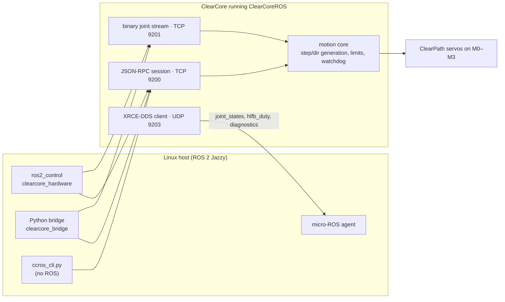

# ClearCoreROS

**Turn a Teknic ClearCore and up to four ClearPath servos into ROS 2 joints.**

ClearCoreROS is firmware for the [Teknic ClearCore](https://teknic.com/products/io-motion-controller/) motion controller, plus the ROS 2 packages and host tools that drive it. The board runs the motors in real time; ROS 2 runs on a Linux host (a Jetson or any Linux machine) and sees connectors M0–M3 as joints with positions in metres or radians.

You can use it as a plain `ros2_control` hardware interface, through a Python bridge with a trajectory action, or without ROS at all from a command-line client.

> [!WARNING]
> **Experimental.** Tested on a bench with ClearPath servos on M0 and M1. Not certified for production or safety-critical use. Keep a physical E-stop in the motor power circuit.

## Highlights

- **Four joints.** M0–M3 as `joint_x` … `joint_a` by default, each with its own name, linear or rotary units, direction, gear ratio and offset.
- **Three ways to use it from ROS 2.** A `ros2_control` `SystemInterface`, a Python bridge with `FollowJointTrajectory`, or publish-only micro-ROS telemetry straight from the board.
- **Real motion on the board.** Coordinated linear and arc moves, timed trajectory following, homing to limit switches and probing.
- **Safety built in.** E-stop input, ClearPath HLFB "ready" check, soft limits, NO/NC limit switches, and a watchdog that stops the motors if the host goes quiet.
- **Configure once.** Settings live in the board's flash, set from the host, the CLI, or a menu on the USB port.
- **No ROS needed to start.** Flash the released firmware and move a motor with a Python CLI.

## How it works



The ClearCore is too small to run a ROS 2 node itself, so the board is the motor side of the system:

| Link | Port | Carries |
|------|------|---------|
| JSON-RPC session | TCP 9200 | Configuration, enable/disable, moves, homing, status. One client. |
| Binary joint stream | TCP 9201 | High-rate joint state out, position or velocity commands in. One client. |
| Discovery | UDP 9202 | Finding boards on the network. |
| XRCE-DDS | UDP 9203 | `sensor_msgs/JointState`, HLFB duty and `DiagnosticArray`, published through a micro-ROS agent onto the ROS graph. Publish only. |

Reported positions are the steps the board has generated, not a shaft encoder reading. The full wire format is in [PROTOCOL.md](PROTOCOL.md).

## Choose a setup

All of these talk to the same firmware. Only one should command motion at a time, and only one should be the `/joint_states` source you read.

| Setup | What you run | Who commands motion | Who publishes `/joint_states` |
|-------|--------------|---------------------|-------------------------------|
| **First motor, no ROS** | `host/ccros_cli.py` | You, through the session | Nobody |
| **`ros2_control`** | `clearcore_hardware` plus a controller | The controller, over the session and stream | `joint_state_broadcaster` |
| **Python bridge** | `clearcore_bridge` | Its `follow_joint_trajectory` action | The bridge |
| **XRCE telemetry** | `xrce-connect` and a micro-ROS agent | Nobody (publish only) | The agent node `clearcore_ros` |

The session and stream ports each take one client, so the bridge and the `ros2_control` plugin can't run at the same time.

Default joints (rename and rescale them with `configure`):

| Joint | Motor | Unit |
|-------|-------|------|
| `joint_x` | M0 | metres |
| `joint_y` | M1 | metres |
| `joint_z` | M2 | metres |
| `joint_a` | M3 | radians |

## What you need

| Part | Notes |
|------|-------|
| Teknic ClearCore | Runs the firmware. |
| ClearPath servos | Step and direction on M0–M3, HLFB set to ASG-Position with measured torque (482 Hz). |
| E-stop | Wired to DI-6 (active low by default). |
| Linux host | ROS 2 Jazzy, on the same network as the board. Only needed for the ROS setups. |
| To build the firmware | Microchip/Atmel Studio 7. Not needed if you flash a released image. |

## Getting started

### 1. Get the source

The firmware builds against [EnhancedClearCoreLibrary](https://github.com/AGSweeney/EnhancedClearCoreLibrary), included as a submodule:

```bash
git clone --recurse-submodules https://github.com/AGSweeney/ClearCore_ROS.git
```

On Windows, run `git config --global core.longpaths true` first; some library paths are longer than 260 characters.

### 2. Move one motor (no ROS)

Follow [docs/FIRST_MOTOR.md](docs/FIRST_MOTOR.md): flash the released image ([releases/](releases/README.md)), connect one ClearPath to M0, and drive it with the CLI:

```powershell
python host/ccros_cli.py --host <board-ip or subnet broadcast> discover
python host/ccros_cli.py --host <board-ip> enable
python host/ccros_cli.py --host <board-ip> move --x 0.01      # 10 mm
python host/ccros_cli.py --host <board-ip> disable
```

### 3. Add ROS 2

On the Linux host:

```bash
cd ros2_ws
colcon build --symlink-install
source install/setup.bash

ros2 launch clearcore_hardware hardware.launch.py host:=<board-ip>        # ros2_control
ros2 launch clearcore_bridge bridge.launch.py host:=<board-ip> axis_mask:=3   # or the Python bridge
```

Network settings, the USB setup menu, the trajectory controller launch, XRCE and the bench results are in [docs/USAGE.md](docs/USAGE.md).

## Documentation

| Document | Contents |
|----------|----------|
| [docs/FIRST_MOTOR.md](docs/FIRST_MOTOR.md) | One motor from the released firmware, no ROS install |
| [docs/USAGE.md](docs/USAGE.md) | Firmware and releases, network, USB setup menu, bench walkthrough, XRCE-DDS, ROS 2 details, tests, safety |
| [PROTOCOL.md](PROTOCOL.md) | Session methods, binary frames, NVM layout, limits, XRCE topics |
| [docs/VALIDATION.md](docs/VALIDATION.md) | What has been verified, in simulation and on hardware |
| [docs/CLEARPATH_USB.md](docs/CLEARPATH_USB.md) | Reading a ClearPath's own alerts and tracking error over its USB port |
| [docs/DDS_COMMAND_PLAN.md](docs/DDS_COMMAND_PLAN.md) | Planned: commanding the board directly over DDS |
| [releases/README.md](releases/README.md) | Firmware images and what each was tested on |

## Testing

These run without a board; CI runs them on every push with ROS 2 Jazzy:

```powershell
python host/run_ci_tests.py
```

A green CI run means the simulated-hardware tests passed. It is not proof that physical homing or fault recovery works; those results are tracked in [docs/VALIDATION.md](docs/VALIDATION.md).

## Repository layout

| Path | Contents |
|------|----------|
| `firmware/` | ClearCore firmware (Microchip Studio project) |
| `ros2_ws/src/clearcore_hardware` | `ros2_control` hardware interface and launch files |
| `ros2_ws/src/clearcore_bridge` | Python bridge: `/joint_states`, services, trajectory action |
| `host/` | CLI, simulated-host tests, bench and endurance scripts, ClearPath USB tool |
| `releases/` | Released firmware images |
| `docs/` | Guides and reference |
| `external/EnhancedClearCoreLibrary` | Submodule: ClearCore library and lwIP for the firmware build |
| `logs/` | Hardware test run logs |

## License

MIT License, Copyright (c) 2026 Adam G. Sweeney. See [LICENSE](LICENSE). The ClearCore library submodule and the bundled jsmn tokenizer keep their own licences; see [THIRD_PARTY_NOTICES.md](THIRD_PARTY_NOTICES.md).
